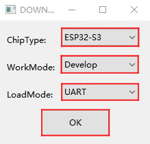
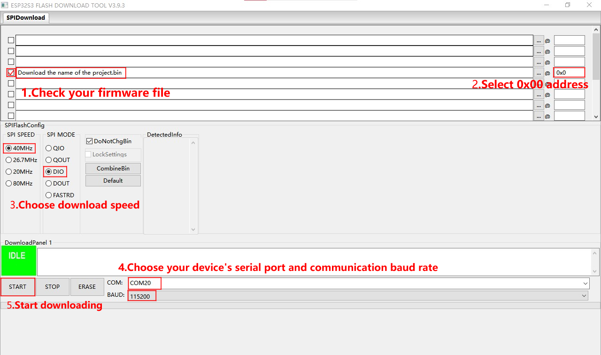

<!--
 * @Description: None
 * @Author: LILYGO_L
 * @Date: 2023-09-11 16:13:14
 * @LastEditTime: 2026-04-10 15:54:21
 * @License: GPL 3.0
-->
# VW ECU Reader

基于 LILYGO T-2CAN V1.0 的 OBD-II 数据读取项目。Mac、Windows 或手机可以用浏览器查看转速、水温、车速、计算负荷、节气门开度和进气温度，并下载 CSV。不支持的项目留空。当前固件只支持经典 CAN、`500 kbit/s`、11 位诊断 ID，不保证适配所有车辆。

离车台架连续六次通过。2020 年 9 月出厂的迈腾曾读到六项 ECU 数据，实车复测发现间歇性 CAN ACK 缺失。 [开发与排错记录](./docs/DEVELOPMENT.md)

## 硬件与购买

- [LILYGO 原产品 GitHub](https://github.com/Xinyuan-LilyGO/T-2Can) · [官方产品说明](https://wiki.lilygo.cc/products/industrial-series/t-2can/) · [LILYGO 商城](https://lilygo.cc/products/t-2can) · [LILYGO 官方淘宝店](https://shop140839766.taobao.com/)
- 本项目用 **T-2CAN V1.0 普通版**，选购时确认带 `MCP2515`，不要选 T-2CAN-FD。板上主控是 ESP32-S3，A 路使用 `MCP2515`，B 路使用 ESP32-S3 内置 `TWAI`。[V1.0 原理图](./project/T-2Can_V1.0.pdf) · [原板中文资料](./README_CN.md)
- 还需要 USB-C **数据线**、OBD-II 公头转散线、万用表。使用网页时装上随板或匹配的 `2.4 GHz` 外接天线；离开电脑后可以用 `5 V` USB 充电宝供电。


图片来源：[LILYGO 官方 Wiki](https://wiki.lilygo.cc/products/industrial-series/t-2can/)（[另一张实物图](https://wiki.lilygo.cc/products/industrial-series/t-2can/index/image/t-2can-2.jpg)）。淘宝链接为官方店铺入口，未核实独立商品页或库存。

## 买板后的调整

1. **先进行台架测试，不接车。** 保留出厂的两路终端电阻，断电后用三根短线连接 `CANHA ↔ CANHB`、`CANLA ↔ CANLB`、`SGNDA ↔ SGNDB`。刷入 `obd2_bench`，打开 `115200` 串口并按 `t`。看到 `OBD-II BENCH PASS` 即通过；`800 rpm` 和 `90 C` 是模拟值。
2. **为接车处理 B 路终端。** 拔掉 USB、车端 OBD 和三根台架跳线。由熟悉贴片焊接的人按[原理图](./project/T-2Can_V1.0.pdf)核对并移除 **B 路 `RZ1`（120 Ω）**，不要短接空焊盘，也不拆 A 路的终端。不要凭照片左右或电阻上 `121` 的标记判断是哪一路。[外部诊断设备的终端要求](https://law.resource.org/pub/us/cfr/ibr/inc/iso/iso.15765-4.2005.pdf#page=25)
3. **断电复测。** A 路 `CANHA ↔ CANLA` 应仍约 `120 Ω`；B 路 `CANHB ↔ CANLB` 应明显高于拆除前，万用表可能显示 `OL`，不是 `0 Ω`。若 B 路仍约 `120 Ω` 或接近 `0 Ω`，不要接车。电阻复测不能证明 CAN 收发正常；建议在台架复测拆焊后的 B 路，若用了临时外接终端，接车前也要拔掉。
4. **刷回 `obd2_read`，然后接车。** `original_test` 和 `obd2_bench` 都仅用于台架。刷写时板子只连电脑 USB，OBD 必须与车辆断开。

## 编译与刷写

安装 VS Code 的 [PlatformIO IDE](https://docs.platformio.org/en/latest/integration/ide/vscode.html) 扩展。在工程根目录打开 PlatformIO 终端，`pio device list` 可查串口。以下以 Windows 的 `COM3` 为例；Mac 请换成实际的 `/dev/cu.usbmodem...` 设备。刷写前关闭已占用端口的监视器。

```sh
# 台架固件，仅在 A/B 互测时使用
pio run -c platformio-obd2-bench.ini -j 1 -t upload --upload-port COM3
pio device monitor --port COM3 --baud 115200
```

实车版默认不启动热点。需要网页时，在本地 `examples/obd2_read/wifi.local.h` 定义自己的 8 到 63 字符密码；该文件已被 Git 忽略，不要提交。**不给密码也可以串口使用。**

```cpp
#pragma once
#define OBD2_AP_PASSWORD "replace-with-your-own-password"
```

```sh
# 实车只读版，可先执行第一条命令确认能够编译
pio run -c platformio-obd2-read.ini -j 1
pio run -c platformio-obd2-read.ini -j 1 -t upload --upload-port COM3
pio device monitor --port COM3 --baud 115200 --echo
```

`OBD-II READ ONLY | CAN B 500 kbit/s | idle` 表示实车版已启动。实车版、诊断版、台架版和单板自检版每次通过 PlatformIO 构建或刷写时，都会把带 UTC 构建时间的版本号写进固件，并在启动时通过串口显示版本号、构建环境和 Git 提交号。Git 有本地改动时显示 `+dirty`。实车版和诊断版可在 `115200` 串口输入 `version` 并回车查询，台架版和单板自检版按 `v` 查询。版本查询不会触发 CAN 请求。用旧的 `.bin` 恢复时，恢复的是该文件原有的版本。

## Windows 串口仪表盘

用 USB 接板子，打开 `VW ECU Reader` 桌面程序，选择 `COM3` 或实际的串口并点击「连接」。串口一次只能由一个程序使用，连接前关闭 PlatformIO 串口监视器。

连接后可以接收板子已有的读数。点击「读取一次」会发一条 `read` 指令。也可以开启连续读取，每轮结束后约 3 秒再读一次，遇到发送失败、回包超时等读取错误会暂停。主界面同时显示六项读数和各自的趋势。点击任一指标的「独立窗口」，可以单独查看并调整窗口大小。右侧可保存串口日志。仪表盘兼容原版只读固件及带版本号的只读版和诊断版。

仪表盘每读完一轮就自动保存读数和失败原因。顶部「存储」可在 SQLite 和 Memurai 之间切换，窗口下方显示连接和保存状态。切换后，新完成的读取写入所选存储。

- SQLite 是默认选项，数据库位于 `%LOCALAPPDATA%\VwEcuReader\readings.sqlite3`。首次写入时创建数据库，按采样时间建立索引。
- Memurai 连接本机 `127.0.0.1:6379`，读数写入 `vw-ecu-reader:readings` Stream。重启后能恢复到哪个时间点，取决于 Memurai 的快照或 AOF 持久化设置。

板载 CSV 用于脱离电脑时记录数据。

桌面仪表盘的「变速箱」页可识别 DQ381。刷入支持该功能的实车版固件后，停车挂 P 挡并打开点火，连接板子，暂停连续读取，再点「读取 TCU 信息」。软件件号、软件版本和 ODX 数据集会显示在页面上，原始响应可通过「保存日志」导出。程序使用 B 路向 `0x7E1` 发出 UDS 只读识别请求，并接收 `0x7E9` 的响应。实车油温等实时值需要先核实这台 TCU 对应的测量项定义。

从源码运行需要 Windows 和 .NET 10 SDK，在仓库根目录执行：

```powershell
dotnet run --project desktop/VwEcuReader.csproj
```

## 首次接车与读取

布线时拔掉 USB，OBD 公头也不要插车。按插头针脚编号用万用表核线，不按导线颜色猜测。A 路和两位直流供电端子都留空，不接台架跳线或额外终端电阻。[J1962 针脚参考](https://www.ni.com/en/support/documentation/supplemental/18/specifications-for-the-can-obd-ii-cable.html#sae-j1962-connector-wiring)

| OBD-II 针脚 | T-2CAN V1.0 |
| --- | --- |
| `6` / CAN High | `CANHB` |
| `14` / CAN Low | `CANLB` |
| `5` / 信号地 | `SGNDB` |
| `16` / 车端电源正极 | **不接，单独绝缘** |

1. 拧紧端子，把所有未用散线分别绝缘。车辆停稳、挂 P 挡并拉手刹，点火关闭时插入 OBD。然后用 USB 给板子供电，把车辆点火切到 `ON`，先不启动发动机。[诊断工具接入顺序参考](https://www.obdlink.com/windows_qsg_ex/)
2. 配置了热点密码时，Mac 或手机连接 `B85380`，在浏览器打开 [http://192.168.4.1/](http://192.168.4.1/)，点一次**读取一次**；也可以在 USB 串口输入 `read` 并回车。不需要安装 App。发动机未启动时 `0 rpm` 是有效读数，`—` 则表示没有该项数据。没有结果时先检查点火状态和接线，不要连续重试。
3. 查询结果追加到板载 `obd2-v2.csv`，可从网页下载；旧版 `obd2.csv` 保留。时间字段是启动编号和开机后的毫秒数，不是实时时钟。曲线随新的手动读数更新。

**只读不等于 Listen-only。** 待机时 CAN B 控制器停用；手动读取时才进入正常模式发送标准 OBD-II 查询，结束后停用。不清码、不写 ECU，也不自动轮询。连接热点、打开或刷新网页、下载 CSV 均不会触发 CAN 查询。[ESP32-S3 TWAI 模式说明](https://docs.espressif.com/projects/esp-idf/en/v4.4.4/esp32s3/api-reference/peripherals/twai.html#operating-modes)

## LILYGO 原板资料

以下是通用开发板参考。用于本项目时，以前面的固件和接车步骤为准。

## VersionIteration:
| Version                               | Update date                       |Update description|
| :-------------------------------: | :-------------------------------: |:--------------: |
| T-2Can_V1.0                      | 2025-07-07                    |   Original version      |
| T-2Can-Fd_V1.0                      | 2026-04-10                    |   Can fd version      |

## PurchaseLink

| Product                     | SOC           |  FLASH  |  PSRAM   | Link                   |
| :------------------------: | :-----------: |:-------: | :---------: | :------------------: |
| T-2Can_V1.0   | NULL |   NULL   | NULL |  [LILYGO Mall](https://lilygo.cc/products/t-2can?_pos=1&_sid=a2c4b89a1&_ss=r&variant=51355687583925)   |
| T-2Can-Fd_V1.0   | NULL |   NULL   | NULL |  [NULL]()   |

## Directory
- [Describe](#describe)
- [Preview](#preview)
- [Module](#module)
- [SoftwareDeployment](#SoftwareDeployment)
- [PinOverview](#pinoverview)
- [RelatedTests](#RelatedTests)
- [FAQ](#faq)
- [Project](#project)

## Describe

The T-2Can is a board developed based on the ESP32-S3 chip and features two CAN buses. The T-2Can-Fd is the FD version of the T-2Can, adding CAN FD functionality. The CAN module used on the T-2Can is the MCP2515, while the CAN module used on the T-2Can-Fd is the MCP2518.

## Preview

### Actual Product Image

See the [official T-2CAN product photo](https://wiki.lilygo.cc/products/industrial-series/t-2can/index/image/t-2can-1.jpg).

## Module

### 1. Core Processor  

* Module: ESP32-S3-WROOM-1U（MCN16R8）
* Related documentation: 
    >[Espressif](https://www.espressif.com/en/support/documents/technical-documents)
    
### 2. CAN chip

> #### T-2Can_V1.0 version
> * Chip: MCP2515
> * Communication Protocol: Spi
> * Related documentation: 
>    >[MCP2515T-E-SO](./docs/MCP2515T-E-SO.pdf)
> * Dependent libraries: 
>    >[arduino-mcp2515](https://github.com/autowp/arduino-mcp2515)

> #### T-2Can-Fd_V1.0 version
> * Chip: MCP2518
> * Communication Protocol: Spi
> * Related documentation: 
>    >[MCP2518FDT-E-SL](./docs/MCP2518FDT-E-SL.pdf)
> * Dependent libraries: 
>    >[Longan_CANFD](https://github.com/Longan-Labs/Longan_CANFD)

## SoftwareDeployment

### Examples Support

| Example | `[Platformio IDE][espressif32-v6.5.0]`<br />`[Arduino IDE][esp32_v2.0.14]` | Description | Picture |
| ------  | ------ | ------ | ------ | 
| [can](./examples/can) |  <p align="center">![alt text][supported] | | |
| [original_test](./examples/original_test) |  <p align="center">![alt text][supported] | factory example | |

[supported]: https://img.shields.io/badge/-supported-green "example"

| Firmware | Description | Picture |
| ------  | ------  | ------ |
| [original_test](./firmware/[T-2Can_V1.0][original_test]_firmware/) | factory example  |  |
| [original_test (can fd)](./firmware/[T-2Can-Fd_V1.0][original_test]_firmware/) | can fd factory example  |  |

### PlatformIO
1. Install [VisualStudioCode](https://code.visualstudio.com/Download) ,Choose installation based on your system type.

2. Open the "Extension" section of the Visual Studio Code software sidebar(Alternatively, use "<kbd>Ctrl</kbd>+<kbd>Shift</kbd>+<kbd>X</kbd>" to open the extension),Search for the "PlatformIO IDE" extension and download it.

3. During the installation of the extension, you can go to GitHub to download the program. You can download the main branch by clicking on the "<> Code" with green text, or you can download the program versions from the "Releases" section in the sidebar.

4. After the installation of the extension is completed, open the Explorer in the sidebar(Alternatively, use "<kbd>Ctrl</kbd>+<kbd>Shift</kbd>+<kbd>E</kbd>" go open it),Click on "Open Folder," locate the project code you just downloaded (the entire folder), and click "Add." At this point, the project files will be added to your workspace.

5. Open the "platformio.ini" file in the project folder (PlatformIO will automatically open the "platformio.ini" file corresponding to the added folder). Under the "[platformio]" section, uncomment and select the example program you want to burn (it should start with "default_envs = xxx") Then click "<kbd>[√](image/4.png)</kbd>" in the bottom left corner to compile,If the compilation is correct, connect the microcontroller to the computer and click "<kbd>[→](image/5.png)</kbd>" in the bottom left corner to download the program.

### Arduino
1. Install [Arduino](https://www.arduino.cc/en/software) ,Choose installation based on your system type.

2. Open the "example" directory within the project folder, select the example project folder, and open the file ending with ".ino" to open the Arduino IDE project workspace.

3. Open the "Tools" menu at the top right -> Select "Board" -> "Board Manager." Find or search for "esp32" and download the board files from the author named "Espressif Systems." Then, go back to the "Board" menu and select the development board type under "ESP32 Arduino." The selected development board type should match the one specified in the "platformio.ini" file under the [env] section with the header "board = xxx." If there is no corresponding development board, you may need to manually add the development board from the "board" directory within your project folder.

4. Open menu bar "[File](image/6.png)" -> "[Preferences](image/6.png)" ,Find "[Sketchbook location](image/7.png)"  here,copy and paste all library files and folders from the "libraries" folder in the project directory into the "libraries" folder in this directory.

5. Select the correct settings in the Tools menu, as shown in the table below.

#### ESP32-S3
| Setting                               | Value                                 |
| :-------------------------------: | :-------------------------------: |
| Board                                 | ESP32S3 Dev Module           |
| Upload Speed                     | 921600                               |
| USB Mode                           | Hardware CDC and JTAG     |
| USB CDC On Boot                | Enabled                              |
| USB Firmware MSC On Boot | Disabled                             |
| USB DFU On Boot                | Disabled                             |
| CPU Frequency                   | 240MHz (WiFi)                    |
| Flash Mode                         | QIO 80MHz                         |
| Flash Size                           | 16MB (128Mb)                    |
| Core Debug Level                | None                                 |
| Partition Scheme                | 16M Flash (3MB APP/9.9MB FATFS) |
| PSRAM                                | OPI PSRAM                         |
| Arduino Runs On                  | Core 1                               |
| Events Run On                     | Core 1                               |           

6. Select the correct port.

7. Click "<kbd>[√](image/8.png)</kbd>" in the upper right corner to compile,If the compilation is correct, connect the microcontroller to the computer,Click "<kbd>[→](image/9.png)</kbd>" in the upper right corner to download.

### firmware download
1. Open the project file "tools" and locate the ESP32 burning tool. Open it.

2. Select the correct burning chip and burning method, then click "OK." As shown in the picture, follow steps 1->2->3->4->5 to burn the program. If the burning is not successful, press and hold the "BOOT-0" button and then download and burn again.

3. Burn the file in the root directory of the project file "[firmware](./firmware/)" file,There is a description of the firmware file version inside, just choose the appropriate version to download.

<p align="center" width="100%">
    
    
</p>


## PinOverview

For pin definitions, please refer to the configuration file: [pin_config.h](./libraries/private_library/pin_config.h)

## RelatedTests

## FAQ

* Q. After reading the above tutorials, I still don't know how to build a programming environment. What should I do?
* A. If you still don't understand how to build an environment after reading the above tutorials, you can refer to the [LilyGo-Document](https://github.com/Xinyuan-LilyGO/LilyGo-Document) document instructions to build it.

<br />

* Q. Why does Arduino IDE prompt me to update library files when I open it? Should I update them or not?
* A. Choose not to update library files. Different versions of library files may not be mutually compatible, so it is not recommended to update library files.

<br />

* Q. Why is there no serial data output on the "Uart" interface on my board? Is it defective and unusable?
* A. The default project configuration uses the USB interface as Uart0 serial output for debugging purposes. The "Uart" interface is connected to Uart0, so it won't output any data without configuration.<br />For PlatformIO users, please open the project file "platformio.ini" and modify the option under "build_flags = xxx" from "-D ARDUINO_USB_CDC_ON_BOOT=true" to "-D ARDUINO_USB_CDC_ON_BOOT=false" to enable external "Uart" interface.<br />For Arduino users, open the "Tools" menu and select "USB CDC On Boot: Disabled" to enable the external "Uart" interface.

<br />

* Q. Why is my board continuously failing to download the program?
* A. Please hold down the "BOOT-0" button and try downloading the program again.

## Project
* [T-2Can_V1.0](./project/T-2Can_V1.0.pdf)
* [T-2Can-Fd_V1.0](./project/T-2Can-Fd_V1.0.pdf)

